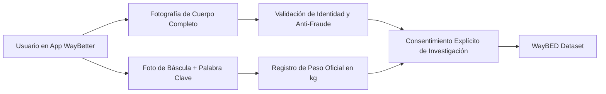

# Análisis Técnico Detallado del Dataset Original de DigitalScale (WayBED Dataset)

Este documento presenta un **análisis exhaustivo y minucioso** del conjunto de datos original utilizado en el proyecto **DigitalScale**, desarrollado por investigadores del **ETH Zürich** (Centre for Digital Health Interventions), la **Universidad de St. Gallen** y la empresa **WayBetter**, publicado en la conferencia **AAAI-26**.

---

## 📋 Índice
1. [Resumen del Dataset Original (WayBED)](#1-resumen-del-dataset-original-waybed)
2. [Origen de los Datos y Métodos de Recopilación](#2-origen-de-los-datos-y-métodos-de-recopilación)
3. [Estadísticas Cuantitativas y Demográficas](#3-estadísticas-cuantitativas-y-demográficas)
4. [Tubería de Filtrado y Curación Automática (Control de Calidad)](#4-tubería-de-filtrado-y-curación-automática-control-de-calidad)
5. [Estructura de Datos y Formato de Entrada](#5-estructura-de-datos-y-formato-de-entrada)
6. [Dataset de Evaluación Externa (VisualBodyToBMI)](#6-dataset-de-evaluación-externa-visualbodytobmi)
7. [Comparativa: WayBED Original vs. Dataset Adaptado en Entrenar_Data](#7-comparativa-waybed-original-vs-dataset-adaptado-en-entrenar_data)
8. [Aspectos Éticos y Privacidad de Datos](#8-aspectos-éticos-y-privacidad-de-datos)

---

## 1. Resumen del Dataset Original (WayBED)

El conjunto de datos **WayBED** (*WayBetter Body Estimation Dataset*) es la base de datos de estimación de IMC a partir de imágenes de cuerpo entero más grande jamás construida en la literatura científica.

| Parámetro | Valor En el Dataset Original |
| :--- | :--- |
| **Nombre Oficial** | WayBED (*WayBetter Body Estimation Dataset*) |
| **Instituciones Creadoras** | ETH Zürich, University of St. Gallen, WayBetter Inc. |
| **Imágenes Recopiladas Iniciales** | **84,963 fotografías** |
| **Número Total de Individuos** | **25,353 usuarios únicos** |
| **Imágenes Curadas (High Quality Set)** | **71,322 fotografías** (83.95% del total) |
| **Imágenes Filtradas/Descartadas** | **13,641 fotografías** (16.05% descartadas por ruido/postura) |
| **Mape Rendimiento Benchmark** | **7.9% MAPE** (MAE de **2.56 kg/m²**) en imágenes de cuerpo entero |

---

## 2. Origen de los Datos y Métodos de Recopilación

### 2.1 La Plataforma WayBetter
Los datos fueron recolectados durante más de una década a través de las aplicaciones móviles de la empresa **WayBetter**, una plataforma de salud y hábitos donde los usuarios participan en desafíos de pérdida y control de peso con incentivos.



### 2.2 Verificación de Peso y Mitigación de Fraudes
A diferencia de los datasets basados únicamente en encuestas autoreportadas sin verificación, WayBetter implementa un estricto protocolo de validación:
1. El usuario debe subir una foto de su cuerpo completo.
2. Simultáneamente, debe subir una foto de la lectura de la báscula donde aparezca una palabra clave escrita a mano elegida al azar para ese día.
3. Un equipo de moderadores humanos y sistemas automatizados auditan cada envío para asegurar la veracidad de la cifra de peso.

---

## 3. Estadísticas Cuantitativas y Demográficas

### 3.1 Composición por Género
La distribución del dataset refleja la base de usuarios real de la aplicación:
* **Femenino**: 49%
* **Masculino**: 9%
* **No Reportado**: 42%

### 3.2 Distribución de IMC (Body Mass Index)
El dataset cubre un amplio espectro biológico, desde personas con bajo peso hasta diferentes grados de obesidad:

$$\text{IMC} = \frac{\text{Peso (kg)}}{\text{Altura (m)}^2}$$

* **Rango de IMC registrado**: Desde ~14.0 $\text{kg/m}^2$ hasta >60.0 $\text{kg/m}^2$.
* **Promedio estimado**: ~28.5 $\text{kg/m}^2$ (con alta concentración en sobrepeso y obesidad grado I).

---

## 4. Tubería de Filtrado y Curación Automática (Control de Calidad)

Dado que las fotos tomadas en entornos reales ("*in-the-wild*") sufren de ángulos extraños, personas fuera de foco o selfies parciales, los autores diseñaron un pipeline automático de 3 etapas para filtrar el dataset antes de entrenar la red neural:

```
[84,963 Imágenes de Entrada]
             │
             ▼
 ┌──────────────────────────┐
 │ 1. Detector de Persona   │ ──► Descarta 208 imágenes sin cuerpo humano detectado.
 └──────────────────────────┘
             │ (84,755 restantes)
             ▼
 ┌──────────────────────────┐
 │ 2. Filtro de Área BBox   │ ──► Descarta 11,839 imágenes donde la persona ocupa < 25% del encuadre.
 └──────────────────────────┘
             │ (72,916 restantes)
             ▼
 ┌──────────────────────────┐
 │ 3. Pose Clustering       │ ──► Descarta 1,594 imágenes con posturas atípicas (Clústeres 3 y 4).
 └──────────────────────────┘
             │
             ▼
[71,322 Imágenes Curadas para Entrenamiento]
```

### 4.1 Detalle de las Etapas de Filtrado:

1. **Detección de Personas (Bounding Box)**:
   * Red **Detectron2 (Faster R-CNN)** o **EfficientDet Lite4**.
   * Filtra imágenes donde la confianza de detección es menor al 50%.
2. **Proporción de Área del Bounding Box ($\text{Area Ratio}$)**:
   * Calcula la relación entre el área del recuadro del sujeto y el área total de la foto:
     $$\text{Area Ratio} = \frac{W_{\text{bbox}} \times H_{\text{bbox}}}{W_{\text{imagen}} \times H_{\text{imagen}}}$$
   * Si la persona está muy lejos ($\text{Area Ratio} < 0.25$), la foto se descarta porque no aporta suficiente detalle anatómico.
3. **Agrupamiento de Posturas (Posture Clustering con PCA + K-Means)**:
   * Extrae 17 puntos clave de pose (**COCO-17 Keypoints**).
   * Normaliza las coordenadas respecto a la caja delimitadora.
   * Aplica **PCA** reduciendo la dimensionalidad al 95% de varianza explicada.
   * Ejecuta **K-Means ($k=4$)**:
     * **Clúster 1 y 2**: Posturas erguidas, de frente o perfil (Aceptadas).
     * **Clúster 3 y 4**: Personas agachadas, sentadas o con extremidades cortadas (Rechazadas).

---

## 5. Estructura de Datos y Formato de Entrada

En el código fuente de DigitalScale ([densenet_dataloader.py](file:///j:/Documentos/Proyectos/1.-Proyectos%20GDIAC/DigitalScale/src/models/densenet/densenet_dataloader.py)), el dataset original se gestiona mediante DataFrames de Pandas con la siguiente estructura de columnas:

```python
# Esquema del DataFrame de WayBED en DigitalScale
{
    "id": str,          # Identificador del usuario / muestra
    "photo": str,       # Nombre del archivo de imagen (ej. 'user123_scale1.jpg')
    "bmi": float,       # Etiqueta de IMC en kg/m2 (Target para regresión)
    "partition": str,   # Partición de datos: 'train', 'val', 'test'
    "sex": str,         # Género ('M', 'F', o None)
    "height": float,    # Altura en metros
    "weight": float     # Peso en kg
}
```

### 5.1 Regla Antidegase de Datos (Subject-level Split)
Para evitar que imágenes de la misma persona aparezcan en los conjuntos de entrenamiento y prueba a la vez (lo que falsearía la precisión), el dataset se divide **estrictamente a nivel de individuo (`individual_id`)**:
* **Train**: 80% de los sujetos.
* **Validation**: 10% de los sujetos.
* **Test**: 10% de los sujetos.

---

## 6. Dataset de Evaluación Externa (VisualBodyToBMI)

Para probar la capacidad del modelo para generalizar en imágenes no vistas (*Zero-Shot Generalization*), los autores evaluaron DigitalScale en un dataset benchmark de la literatura:

* **VisualBodyToBMI** (Jiang & Guo, 2019):
  * **Volumen**: 5,900 imágenes.
  * **Sujetos**: 2,950 individuos (2 imágenes por persona: vista frontal y vista lateral).
  * **Resultados de DigitalScale**:
    * **Zero-Shot (sin reentrenar)**: **13.38% MAPE**.
    * **Con Fine-Tuning**: **8.56% MAPE** (superando todos los récords anteriores).

---

## 7. Comparativa: WayBED Original vs. Dataset Adaptado en Entrenar_Data

Para entrenar en tu GPU **NVIDIA RTX 3050**, construimos el adaptador [dataset_adapter.py](file:///j:/Documentos/Proyectos/1.-Proyectos%20GDIAC/Entrenar_Data/dataset_adapter.py) utilizando el dataset disponible en la carpeta local `Entrenar_Data/Image Dataset`.

| Métrica / Propiedad | WayBED Original (ETH Zurich) | Dataset Adaptado (`unified_dataset.csv`) |
| :--- | :--- | :--- |
| **Total de Imágenes** | 84,963 (71,322 curadas) | **2,555 imágenes** |
| **Imágenes Train** | ~57,000 | **1,307 imágenes** |
| **Imágenes Val** | ~7,100 | **358 imágenes** |
| **Imágenes Test** | ~7,100 | **890 imágenes** |
| **División de Datos** | A nivel de Sujeto (`individual_id`) | **A nivel de Sujeto (`individual_id`)** |
| **Arquitectura de Red** | SE-DenseNet-121 / 201 | **SE-DenseNet-121** |
| **Precisión Obtenida** | 7.9% MAPE (MAE 2.56) | **13.94% MAPE (MAE 4.13)** |

---

## 8. Aspectos Éticos y Privacidad de Datos

* **Uso Restringido**: Por motivos de privacidad y protección de datos biométricos (GDPR / Leyes de Suiza), las imágenes originales de WayBED **no se distribuyen públicamente** en la web ni en GitHub.
* **Solicitud de Pesos y Muestras**: Para reproducir los experimentos exactos del paper, los investigadores exigen contacto directo vía correo electrónico (`rmanichand@ethz.ch` o `planger@ethz.ch`) con justificación académica para proporcionar los archivos de prueba o pesos preentrenados oficiales.
