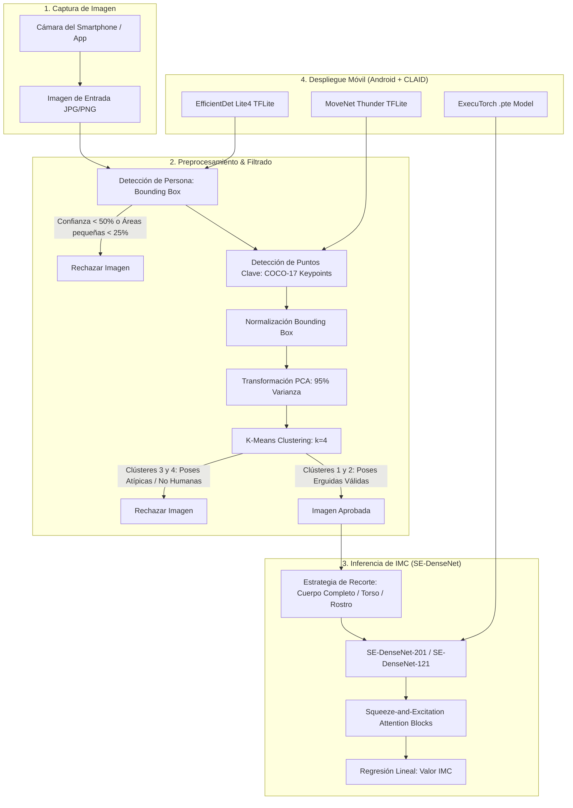

# Análisis Técnico Exhaustivo: Digital Scale (Estimación de IMC en el Dispositivo)

Este documento presenta un **análisis profundo y detallado de pies a cabeza** del repositorio oficial de código abierto [DigitalScale](https://github.com/im-ethz/DigitalScale) desarrollado por el **ETH Zürich** (Centro de Intervenciones de Salud Digital & Laboratorio de Sistemas Agenticos), la **Universidad de St. Gallen** y **WayBetter**, junto con su correspondiente artículo de investigación presentado en **AAAI-26** (*Cuadragésima Conferencia AAAI sobre Inteligencia Artificial*).

---

## 📋 Índice
1. [Resumen Ejecutivo](#1-resumen-ejecutivo)
2. [Arquitectura General del Sistema](#2-arquitectura-general-del-sistema)
3. [Análisis del Conjunto de Datos (WayBED Dataset)](#3-análisis-del-conjunto-de-datos-waybed-dataset)
4. [Tubería de Preprocesamiento y Filtrado Automático](#4-tubería-de-preprocesamiento-y-filtrado-automático)
5. [Modelo de Aprendizaje Profundo (SE-DenseNet)](#5-modelo-de-aprendizaje-profundo-se-densenet)
6. [Resultados Experimentales y Comparativa de Perspectivas](#6-resultados-experimentales-y-comparativa-de-perspectivas)
7. [Despliegue en Dispositivos Móviles (Android + CLAID + ExecuTorch)](#7-despliegue-en-dispositivos-móviles-android--claid--executorch)
8. [Estructura del Código del Repositorio](#8-estructura-del-código-del-repositorio)
9. [Limitaciones, Desafíos y Oportunidades de Mejora](#9-limitaciones-desafíos-y-oportunidades-de-mejora)
10. [Conclusiones](#10-conclusiones)

---

## 1. Resumen Ejecutivo

La estimación del **Índice de Masa Corporal (IMC / BMI)** a través de fotografías de teléfonos inteligentes representa una alternativa digital no invasiva y en tiempo real para entornos de telesalud, seguimiento de hábitos y situaciones de emergencia donde no se dispone de básculas ni estadiómetros físicos.

### Puntos Clave de la Investigación:
* **Escala Sin Precedentes**: Entrenamiento sobre **WayBED**, un dataset de **84,963 imágenes** pertenecientes a **25,353 individuos**, superando con creces los datasets públicos anteriores (limitados a máximo ~14,500 imágenes faciales o ~5,900 de cuerpo completo).
* **Filtrado Inteligente de Datos**: Implementación de un pipeline de control de calidad automático que combina **detección de personas (bounding box)** y **agrupamiento de posturas (posture clustering mediante PCA + K-Means)** para descartar imágenes ruidosas, recortadas o atípicas (se descartó el 16.2% del dataset, reteniendo 71,322 imágenes de alta calidad).
* **Precisión de Estado del Arte**:
  * **MAPE de 7.9%** (MAE de **2.56 puntos de IMC** y **7.29 kg de peso**) en imágenes de cuerpo entero dentro del conjunto de prueba de WayBED.
  * **Generalización robusta**: **MAPE de 13.38%** en evaluación *zero-shot* (sin reentrenar) en el dataset independiente **VisualBodyToBMI**, y **8.56%** tras aplicar *fine-tuning* (nuevo récord publicado).
* **Despliegue Real On-Device**: Sistema ejecutable de forma 100% local en Android mediante el marco **CLAID** combinando **ExecuTorch** (para PyTorch en móvil) y **TensorFlow Lite** (para detección de persona y pose).

---

## 2. Arquitectura General del Sistema

El flujo completo del sistema se divide en tres fases principales: **Curación de Datos / Preprocesamiento**, **Entrenamiento del Modelo de Visión por Computadora** e **Inferencia en Dispositivo Móvil**.



---

## 3. Análisis del Conjunto de Datos (WayBED Dataset)

### 3.1 Origen y Recopilación
* **Fuente**: Recopilado durante más de una década a través de la aplicación de fitness y pérdida de peso **WayBetter**.
* **Volumen Original**: Más de 5 millones de fotos enviadas por más de 900,000 usuarios.
* **Muestra con Consentimiento**: **84,963 imágenes** de **25,353 usuarios** que dieron consentimiento explícito para uso en investigación científica.
* **Salvaguardas de Privacidad**: Las imágenes no son públicas, no pueden ser objeto de ingeniería inversa ni publicarse directamente. La participación fue totalmente voluntaria.

### 3.2 Demografía y Distribución
* **Género**: 49% Mujeres, 9% Hombres, 42% No especificado/reportado.
* **Variables Etiquetas**:
  * **Peso actual**: Autoreportado por los usuarios al tomar la foto (verificado con foto de la báscula y palabra clave escrita a mano para prevenir fraudes).
  * **Altura**: Autoreportada una sola vez al inicio del programa de salud.
  * **IMC**: Calculado mediante la fórmula estándar: $IMC = \frac{peso (kg)}{altura (m)^2}$.

### 3.3 Datos de Referencia (VisualBodyToBMI)
Para verificar la capacidad de generalización fuera del dominio de entrenamiento (*out-of-distribution*), los autores utilizaron el dataset benchmark **VisualBodyToBMI** (Jiang & Guo 2019):
* 5,900 imágenes de cuerpo completo correspondientes a 2,950 sujetos.

---

## 4. Tubería de Preprocesamiento y Filtrado Automático

En entornos de la vida real (*in-the-wild*), las imágenes tomadas por los usuarios sufren de variaciones extremas en ángulos (selfies), iluminación, ropa y posturas distorsionadas. Para garantizar un entrenamiento y predicción consistentes, los autores desarrollaron un filtro automático en 3 pasos:

```
WayBED (84,963) ──> [1. Person Detector] ──> (84,755) ──> [2. Background Ratio] ──> (72,916) ──> [3. Pose Clustering] ──> Filtrado Final (71,322)
                          │                                     │                                    │
                    (208 rechazados)                     (11,839 rechazados)                  (1,594 rechazados)
```
*(Nota: 13,642 imágenes totales excluidas = 16.2% del conjunto original)*.

### Paso 1: Detección de Personas (Person Detection)
* **Objetivo**: Asegurar que haya un cuerpo humano visible en la toma.
* **Mecanismo**: Utiliza **Detectron2** en backend Python o **EfficientDet-Lite4** en Android.
* **Criterio de exclusión**: Puntuación de confianza del bounding box $< 0.50$.

### Paso 2: Relación Persona-Fondo (Bounding Box Area Ratio)
* **Objetivo**: Eliminar imágenes donde la persona está demasiado lejos de la cámara.
* **Fórmula**: $Ratio = \frac{Ancho_{bbox} \times Alto_{bbox}}{Ancho_{imagen} \times Alto_{imagen}}$
* **Criterio de exclusión**: $Ratio < 0.25$ (si la persona ocupa menos del 25% del área total de la imagen, se rechaza por falta de detalle corporal).

### Paso 3: Agrupamiento de Posturas (Posture Clustering)
* **Objetivo**: Filtrar posturas no erguidas, personas sentadas, selfies con brazos extendidos o fotos no humanas.
* **Extracción de Puntos Clave**: Extracción de 17 puntos clave del esqueleto según la convención **COCO-17** (ojos, oídos, hombros, codos, muñecas, caderas, rodillas, tobillos).
* **Normalización Espacial**: Las coordenadas $(x_i, y_i)$ de cada punto clave se normalizan restando la esquina del bounding box y dividiendo entre su ancho y alto:
  $$x_i^{norm} = \frac{x_i - x_{min}}{Ancho_{bbox}}, \quad y_i^{norm} = \frac{y_i - y_{min}}{Alto_{bbox}}$$
  Esto genera un vector de 34 dimensiones por imagen.
* **Reducción de Dimensionalidad (PCA)**: Se aplica Análisis de Componentes Principales (PCA) conservando el **95% de la varianza total** para eliminar ruido de alta frecuencia.
* **Clustering K-Means ($k=4$)**:
  * **Clústeres 1 y 2 (Aceptados)**: Individuos de pie, postura erguida, vista frontal (variando únicamente si los brazos están al lado o ligeramente elevados).
  * **Clústeres 3 y 4 (Rechazados)**: Posturas atípicas, inclinaciones severas de cámara, selfies o detecciones espurias.

---

## 5. Modelo de Aprendizaje Profundo (SE-DenseNet)

### 5.1 Arquitectura Principal
El modelo se basa en **DenseNet-201** (y su variante ligera **DenseNet-121**), modificadas incorporando módulos de atención **Squeeze-and-Excitation (SE)**.

```
Entrada (3x224x224) ──> Conv 7x7 (stride 2) ──> MaxPool ──> [DenseBlock 1] ──> [Transition 1 + SE Layer]
                                                                                      │
                                                                                [DenseBlock 2]
                                                                                      │
                                                                          [Transition 2 + SE Layer]
                                                                                      │
                                                                                [DenseBlock 3]
                                                                                      │
                                                                          [Transition 3 + SE Layer]
                                                                                      │
                                                                                [DenseBlock 4]
                                                                                      │
                                                                                AdaptiveAvgPool
                                                                                      │
                                                                          Linear Classifier ──> IMC (Escalar)
```

### 5.2 Mecanismo Squeeze-and-Excitation (SE Layer)
Los bloques SE calibran dinámicamente el peso de cada canal de características para enfatizar partes del cuerpo altamente informativas (como el grosor del torso o muslos) sobre el fondo:

1. **Squeeze (Compresión)**: Compresión de información espacial mediante **Global Average Pooling**:
   $$z_c = \frac{1}{H \times W} \sum_{i=1}^H \sum_{j=1}^W u_c(i, j)$$
2. **Excitation (Excitación)**: Captura de dependencias entre canales con dos capas lineales y una reducción de dimensión $r=16$:
   $$s = \sigma(W_2 \cdot \delta(W_1 \cdot z))$$
   donde $\delta$ es ReLU y $\sigma$ es la función Sigmoide.
3. **Escalado**: Multiplicación elemento a elemento de los mapas de características originales por los pesos calculados:
   $$\tilde{X}_c = X_c \cdot s_c$$

### 5.3 Hiperparámetros de Entrenamiento
* **Función de Pérdida**: Error Cuadrático Medio (MSE Loss).
* **Optimizador**: Adam con Tasa de Aprendizaje $lr = 10^{-4}$ y Weight Decay $= 10^{-4}$.
* **Planificador LR**: `ReduceLROnPlateau` (factor 0.1, paciencia de 5 épocas).
* **Normalización de Entrada**: Media y desviación estándar estándar de ImageNet.

---

## 6. Resultados Experimentales y Comparativa de Perspectivas

### 6.1 Impacto del Punto de Vista (Perspectiva de la Imagen)
Los autores evaluaron tres recortes derivados de las imágenes de WayBED:
1. **Cuerpo Completo (Full-Body)**: Imagen completa de cabeza a pies.
2. **Torso hacia Arriba (Torso-Up)**: Recorte desde los ojos hasta las caderas con un 50% de margen de tolerancia.
3. **Solo Rostro (Face-Only)**: Recorte estricto de la cara utilizando la librería **RetinaFace**.

| Perspectiva de Imagen | MAPE (%) | MAE IMC ($\text{kg/m}^2$) | MAE Peso ($\text{kg}$) |
| :--- | :---: | :---: | :---: |
| **Cuerpo Completo (Full-Body)** | **7.90%** | **2.56** | **7.29 kg** |
| **Torso hacia Arriba (Torso-Up)** | 9.10% | 2.97 | 8.41 kg |
| **Solo Rostro (Face-Only)** | 11.10% | 3.66 | 10.38 kg |

> **Conclusión Clave**: Aunque el cuerpo entero otorga la mayor precisión (7.9% MAPE), la perspectiva de torso hacia arriba (9.1% MAPE) demuestra ser una alternativa viable para situaciones en las que la persona no puede tomarse una foto completa de pie.

### 6.2 Evaluación Cross-Dataset en VisualBodyToBMI (Generalización)

| Modelo | Entrenado en | Evaluado en | MAPE (%) |
| :--- | :--- | :--- | :---: |
| DenseNet-121 | WayBED | WayBED Test | 11.70% |
| DenseNet-121 | WayBED | VisualBodyToBMI (*Zero-Shot*) | 23.10% |
| DenseNet-121 | VisualBodyToBMI | VisualBodyToBMI | 9.28% |
| **DenseNet-201** | **WayBED** | **WayBED Test** | **7.90%** |
| **DenseNet-201** | **WayBED** | **VisualBodyToBMI (*Zero-Shot*)** | **13.38%** |
| **DenseNet-201** | **WayBED + Fine-Tuning en VBMI** | **VisualBodyToBMI** | **8.56%** |

> **Hallazgo**: El modelo SE-DenseNet-201 preentrenado en WayBED y ajustado (*fine-tuned*) en VisualBodyToBMI alcanza un **MAPE de 8.56%**, superando el estado del arte anterior registrado en dicho dataset.

---

## 7. Despliegue en Dispositivos Móviles (Android + CLAID + ExecuTorch)

Para garantizar la privacidad del usuario y la factibilidad clínica en entornos remotos sin internet, la inferencia se ejecuta completamente en el dispositivo (*on-device*).

### 7.1 Componentes del Pipeline Android
1. **Framework CLAID (Computing Layer for Actionable Health Insights and Data Collection)**: Funciona como middleware en C++/Java/Python para coordinar la captura de la cámara, el procesamiento y los módulos de inferencia.
2. **Person Detector**: EfficientDet-Lite4 compilado en formato `.tflite` ($640 \times 640$).
3. **Posture Detector**: MoveNet Thunder compilado en formato `.tflite float16` ($256 \times 256$, 17 keypoints).
4. **Posture Classifier**: Exportación de parámetros de `Scaler + PCA + KMeans` en formato ligero `posture_model_params.json`.
5. **BMI Estimator**: Modelo PyTorch `SE-DenseNet` exportado a formato `.pte` mediante **ExecuTorch** (runtime móvil de PyTorch de alto rendimiento).

### 7.2 Flujo de Validación de la App Móvil
```
Cámara (CameraX) ──> EfficientDet ──> ¿Confianza >= 50% y BBox >= 25%? 
                            │
                      (Sí)  ├──> No  ──> Desplegar Alerta: "Persona muy lejos o no detectada"
                            ▼
                     MoveNet Thunder ──> Clustering Pose ──> ¿Clúster 1 o 2?
                                                                 │
                                                           (Sí)  ├──> No ──> Desplegar Alerta: "Por favor póngase de pie erguido frente a la cámara"
                                                                 ▼
                                                         ExecuTorch BMI Model (.pte) ──> Mostrar IMC y Categoría
```

---

## 8. Estructura del Código del Repositorio

A continuación se detalla la función de los componentes principales del repositorio:

```
DigitalScale/
├── app/                                  # Aplicación Móvil Nativa (Android)
│   ├── android/app/src/main/java/com/bmiapp/estimator/
│   │   ├── CameraActivity.kt             # Captura de video/foto con CameraX
│   │   ├── ResultActivity.kt             # Orquestación de inferencia local
│   │   ├── EfficientDetPersonDetector.kt # Wrapper TFLite para EfficientDet
│   │   ├── PostureDetectionClustering.kt # Inferencia de pose con MoveNet + PCA/KMeans
│   │   ├── SkeletonOverlayView.kt        # Overlay visual del esqueleto en tiempo real
│   │   └── ImagePreprocessor.kt          # Normalización y crop de imagen para el modelo
│   └── conversion/
│       ├── convert_model_executorch_fixed.py # Exportación de PyTorch a ExecuTorch (.pte)
│       └── export_posture_model_params.py    # Exportación de PCA/KMeans a JSON
│
├── src/                                  # Código Fuente Python (Backend y Entrenamiento)
│   ├── models/
│   │   ├── densenet/
│   │   │   ├── densenet.py               # Definición de DenseNet + SELayer (SE-DenseNet 121/201)
│   │   │   ├── densenet_trainer.py       # Bucle de entrenamiento y validación PyTorch
│   │   │   └── densenet_dataloader.py    # Datasets PyTorch con data augmentation
│   │   ├── senet.py                      # Implementación PyTorch de Squeeze-and-Excitation
│   │   ├── bounding_box_detection.py     # Wrapper para Detectron2
│   │   └── keypoint_detection.py         # Extractor de puntos clave COCO
│   ├── modules/
│   │   ├── filtering.py                  # Módulo Pydantic para filtrado Venn/SQL de imágenes
│   │   └── torso_crop.py                 # Algoritmo de recorte de torso basado en hombros/ojos
│   ├── claid_modules/                    # Módulos Python integrados con la plataforma CLAID
│   └── scripts/
│       ├── train_visual_bmi_densenet.py  # Script principal de entrenamiento multi-GPU
│       ├── finetune_densenet.py          # Script de ajuste fino en VisualBodyToBMI
│       ├── train_posture_clustering.py   # Entrenamiento de PCA + K-Means para poses
│       ├── predict_posture.py            # Inferencia rápida de postura
│       └── densenet_forwardpass.py       # Script de inferencia batch
│
├── get_started/                          # Entorno de Inicio Rápido Simplificado
│   ├── predict_bmi.py                    # Script ejecutable de inferencia de 1 línea
│   ├── dataset.py                        # Cargador liviano de datos de ejemplo
│   └── model.py                          # Definición autónoma de SE-DenseNet
│
├── trained_models/keypoint_models/       # Pesos serializados de PCA, Scaler y KMeans (.pkl)
├── config.claid                          # Configuración del servidor/cliente CLAID
└── requirements.txt                      # Dependencias Python (torch, torchvision, detectron2, etc.)
```

---

## 9. Limitaciones, Desafíos y Oportunidades de Mejora

### 9.1 Limitaciones Identificadas por los Autores
1. **Estimación a partir de una Única Imagen Estática**: La variabilidad en la ropa abultada (abrigos, chaquetas) puede distorsionar el contorno corporal real. La integración de múltiples tomas desde ángulos laterales o videos cortos podría mitigar este margen de error.
2. **Ausencia de Referencia de Escala Física**: La distancia de la persona a la cámara altera la escala absoluta. Agregar un objeto de dimensión conocida (como una tarjeta de crédito o una hoja A4) en la escena podría estandarizar la escala física.
3. **Etiquetas Autoreportadas**: Aunque el peso se verificó en gran medida con fotos de la báscula, la altura fue autoreportada al inicio del programa, lo que introduce un pequeño grado de imprecisión en los datos de entrenamiento.
4. **Desequilibrio Demográfico de Género**: El dataset cuenta con un 49% de mujeres y solo un 9% de hombres identificados (con un 42% no reportado), lo que podría requerir ajustes de equidad en la recolección futura de datos.

---

## 10. Conclusiones

El proyecto **Digital Scale** marca un hito sustancial en la estimación computacional del IMC al combinar:
1. El **conjunto de datos real de mayor escala** utilizado hasta la fecha (WayBED con >84,000 imágenes).
2. Un **filtro de posturas y calidad automático** riguroso basado en visión por computadora.
3. Una arquitectura optimizada **SE-DenseNet** que logra errores tan bajos como **7.9% MAPE**.
4. Una **implementación real en código abierto** lista para su ejecución **privada y local en smartphones Android** mediante el ecosistema CLAID y ExecuTorch.

---
*Análisis elaborado en base al código fuente del repositorio y al documento científico AAAI-26.*
