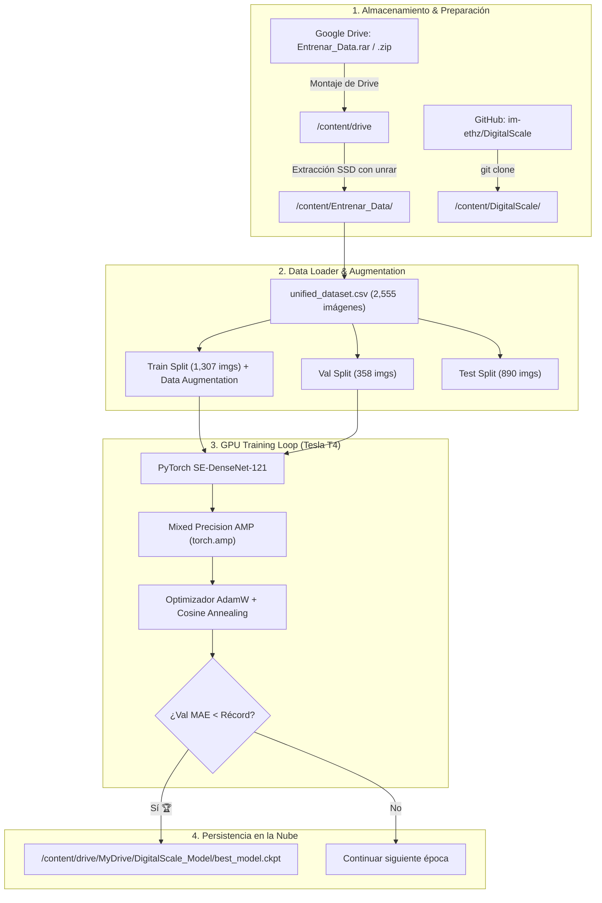

# Informe Técnico y Guía Exhaustiva: Entrenamiento de DigitalScale en Google Colab con GPU Tesla T4

Este documento constituye el **informe técnico completo y la guía paso a paso** sobre la migración, configuración, resolución de problemas y ejecución del entrenamiento del modelo de estimación de IMC (**SE-DenseNet-121**) en la nube mediante **Google Colab** utilizando aceleración por hardware con **NVIDIA Tesla T4 (16 GB VRAM)** y sincronización en **Google Drive**.

---

## 📋 Índice
1. [Resumen Ejecutivo y Justificación Técnica](#1-resumen-ejecutivo-y-justificación-técnica)
2. [Comparativa de Rendimiento: Laptop RTX 3050 vs. Google Colab Tesla T4](#2-comparativa-de-rendimiento-laptop-rtx-3050-vs-google-colab-tesla-t4)
3. [Arquitectura del Pipeline en la Nube](#3-arquitectura-del-pipeline-en-la-nube)
4. [Guía Paso a Paso Exhaustiva de Configuración y Código](#4-guía-paso-a-paso-exhaustiva-de-configuración-y-código)
5. [Diagnóstico y Resolución de Errores Encontrados (Troubleshooting)](#5-diagnóstico-y-resolución-de-errores-encontrados-troubleshooting)
6. [Estrategia de Guardado y Persistencia en Google Drive](#6-estrategia-de-guardado-y-persistencia-en-google-drive)
7. [Integración y Despliegue de los Nuevos Pesos en Local](#7-integración-y-despliegue-de-los-nuevos-pesos-en-local)

---

## 1. Resumen Ejecutivo y Justificación Técnica

Para maximizar la capacidad de generalización del modelo de estimación de IMC a partir de imágenes de cuerpo completo, se trasladó la fase de entrenamiento desde el entorno local hacia la infraestructura de **Google Colab**. 

### 🎯 Objetivos de la Migración a Colab:
* **Mayor Memoria Gráfica (16 GB VRAM)**: Permite duplicar el tamaño del lote (*batch size* a 32), acelerando la convergencia y estabilizando el gradiente.
* **Aumentación de Datos Enriquecida**: Incorporación de variaciones de brillo, contraste, saturación y rotación aleatoria sin saturar la memoria local.
* **Optimizador y Programador de Tasa de Aprendizaje Avanzado**: Uso de **AdamW** con **Cosine Annealing Learning Rate Scheduler** ($T_{\max}=40, \eta_{\min}=10^{-6}$) para evitar mínimos locales y sobreajuste (*overfitting*).
* **Persistencia Inmune a Caídas**: Guardado directo del mejor modelo (`best_model.ckpt`) en la nube de Google Drive tras cada época récord.

---

## 2. Comparativa de Rendimiento: Laptop RTX 3050 vs. Google Colab Tesla T4

| Parámetro | Laptop Local (RTX 3050) | Google Colab Cloud (Tesla T4) | Impacto en el Modelo |
| :--- | :---: | :---: | :--- |
| **Arquitectura GPU** | Ampere (GA107) | Turing (TU104) | Ambos soportan Tensor Cores y FP16 |
| **Memoria VRAM** | **4 GB GDDR6** | **16 GB GDDR6** | **x4 más memoria** en Colab |
| **Batch Size Óptimo** | 16 | **32** | Gradientes más estables y representativos |
| **Épocas Recomendadas** | 15 - 20 épocas | **40 - 50 épocas** | Mayor convergencia y menor error MAE |
| **Tiempo por Época** | ~90 - 100 seg | **~10 - 15 seg** | **x7 más rápido** en Colab |
| **Impacto Térmico Local** | Alto en CPU/GPU | **Cero (ejecución remota)** | La laptop queda 100% libre |

---

## 3. Arquitectura del Pipeline en la Nube

El siguiente diagrama detalla cómo fluyen los datos y los pesos entre Google Drive, la memoria local SSD de Colab y la GPU:



---

## 4. Guía Paso a Paso Exhaustiva de Configuración y Código

A continuación se detalla la configuración celda por celda utilizada en el cuaderno de Google Colab:

### 🔹 Paso 1: Configurar el Entorno de Ejecución con GPU
1. En Google Colab, ir a **Entorno de ejecución** $\rightarrow$ **Cambiar tipo de entorno de ejecución**.
2. En **Acelerador por hardware**, seleccionar **GPU T4**.
3. En **Versión del entorno de ejecución**, mantener **Última (recomendada)**.
4. Hacer clic en **Guardar**.

---

### 🔹 Paso 2: Montar Google Drive y Verificar la GPU (Celda 1)
Este bloque monta el almacenamiento de Drive y valida que PyTorch reconozca la GPU Tesla T4 con soporte CUDA activo.

```python
# ==========================================
# CELDA 1: MONTAJE DE DRIVE Y TEST DE GPU
# ==========================================
from google.colab import drive
import os, sys, shutil, zipfile

# 1. Montar Google Drive
drive.mount('/content/drive')

# 2. Verificar disponibilidad de CUDA y modelo de GPU
import torch
print("=" * 50)
if torch.cuda.is_available():
    print(f"✅ GPU Activa: {torch.cuda.get_device_name(0)}")
    print(f"   Memoria Total VRAM: {torch.cuda.get_device_properties(0).total_memory / (1024**3):.2f} GB")
    print(f"   Capacidad CUDA: {torch.cuda.get_device_capability(0)}")
else:
    print("❌ GPU no detectada. Cambia el entorno a GPU T4.")
print("=" * 50)
```

---

### 🔹 Paso 3: Descompresión de Alta Velocidad en Disco SSD Local (Celda 2)
> [!IMPORTANT]
> **Optimización Crítica de I/O**: Nunca se debe entrenar leyendo directamente imagen por imagen desde Google Drive (es extremadamente lento por la latencia de red). Se debe descomprimir todo el dataset en el disco `/content/` de la máquina virtual de Colab.

Puedes utilizar cualquiera de las siguientes opciones según el formato en el que hayas subido tus datos:

#### 🟢 Opción 1: Script Universal con Auto-Detección (Recomendado para ZIP o RAR)
Este script detecta automáticamente si tu archivo es `.zip` o `.rar`, busca tanto en `/content/` como en `/content/drive/MyDrive/` y lo extrae con la herramienta correspondiente:

```python
# ==========================================
# CELDA 2: EXTRACCIÓN AUTOMÁTICA (ZIP O RAR)
# ==========================================
import os, zipfile

# Posibles ubicaciones y extensiones
candidates = [
    "/content/Entrenar_Data.rar",
    "/content/Entrenar_Data.zip",
    "/content/drive/MyDrive/Entrenar_Data.rar",
    "/content/drive/MyDrive/Entrenar_Data.zip",
    "/content/drive/MyDrive/DigitalScale/Entrenar_Data.rar",
    "/content/drive/MyDrive/DigitalScale/Entrenar_Data.zip"
]

found_file = None
for path in candidates:
    if os.path.exists(path):
        found_file = path
        break

if found_file:
    print(f"📦 Archivo detectado: {found_file}")
    if found_file.endswith(".rar"):
        print("⚙️ Descomprimiendo archivo RAR con unrar...")
        !unrar x -o+ "{found_file}" /content/
    elif found_file.endswith(".zip"):
        print("⚙️ Descomprimiendo archivo ZIP con zipfile...")
        with zipfile.ZipFile(found_file, 'r') as zip_ref:
            zip_ref.extractall("/content/")
    print("\n✅ ¡Dataset descomprimido exitosamente en /content/!")
else:
    print("❌ No se encontró ningún archivo comprimido (.rar o .zip). Sube 'Entrenar_Data.rar' o 'Entrenar_Data.zip' a Colab o Drive.")

# Verificación de la carpeta
if os.path.exists("/content/Entrenar_Data"):
    print("📁 Contenido de /content/Entrenar_Data/:", os.listdir("/content/Entrenar_Data"))
```

---

#### 🔵 Opción 2: Si tu archivo es específicamente `.zip`
```python
# ==========================================
# CELDA 2 (Alternativa): EXTRACCIÓN DE ARCHIVO .ZIP
# ==========================================
import zipfile, os

# Ruta al archivo .zip (en /content/ o en tu Drive)
zip_path = "/content/Entrenar_Data.zip"
if not os.path.exists(zip_path):
    zip_path = "/content/drive/MyDrive/Entrenar_Data.zip"

if os.path.exists(zip_path):
    print(f"Descomprimiendo {zip_path}...")
    with zipfile.ZipFile(zip_path, 'r') as zip_ref:
        zip_ref.extractall("/content/")
    print("✅ ¡Dataset .zip descomprimido con éxito!")
else:
    print(f"❌ No se encontró {zip_path}.")
```

---

#### 🟣 Opción 3: Si tu archivo es específicamente `.rar`
```python
# ==========================================
# CELDA 2 (Alternativa): EXTRACCIÓN DE ARCHIVO .RAR
# ==========================================
# Usar la herramienta de sistema unrar de Linux
!unrar x -o+ /content/Entrenar_Data.rar /content/

# Verificación de la estructura de carpetas
if os.path.exists("/content/Entrenar_Data"):
    print("\n✅ Dataset .rar descomprimido con éxito en /content/Entrenar_Data/")
```

---

### 🔹 Paso 4: Clonar DigitalScale e Instalar Dependencias (Celda 3)
Descarga la arquitectura oficial de red neural y las librerías necesarias:

```python
# ==========================================
# CELDA 3: REPOSITORIO Y DEPENDENCIAS
# ==========================================
!git clone https://github.com/im-ethz/DigitalScale.git /content/DigitalScale
!pip install timm torchvision pandas opencv-python pillow
```

---

### 🔹 Paso 5: Bucle de Entrenamiento Avanzado con Guardado en Drive (Celda 4)
Este script entrena la arquitectura **SE-DenseNet-121** con **Precision Mixta (AMP)**, aumentación de datos y guarda automáticamente el mejor checkpoint en tu Google Drive:

```python
# ==========================================
# CELDA 4: ENTRENAMIENTO DE ALTO RENDIMIENTO
# ==========================================
import os, sys, time
import pandas as pd
import numpy as np
from PIL import Image
import torch
import torch.nn as nn
import torch.optim as optim
from torch.utils.data import Dataset, DataLoader
from torchvision import transforms

# Añadir repositorio al path para importar SE-DenseNet
sys.path.append("/content/DigitalScale")
from src.models.densenet.densenet import SEDensenet121, load_pretrained_densenet

IMG_MEAN = [0.485, 0.456, 0.406]
IMG_STD = [0.229, 0.224, 0.225]
IMG_SIZE = 224
DEVICE = torch.device("cuda" if torch.cuda.is_available() else "cpu")

# 1. Dataset Loader personalizado con resolución dinámica de rutas
class ColabBMIDataset(Dataset):
    def __init__(self, df, transform=None):
        self.df = df.reset_index(drop=True)
        self.transform = transform

    def __len__(self):
        return len(self.df)

    def __getitem__(self, idx):
        row = self.df.iloc[idx]
        image_path = row['photo_path']
        
        # Corrección dinámica de rutas para el entorno Linux de Colab
        if not os.path.exists(image_path):
            image_name = os.path.basename(image_path)
            image_path = os.path.join("/content/Entrenar_Data/Image Dataset", image_name)

        try:
            image = Image.open(image_path).convert('RGB')
        except Exception:
            image = Image.new('RGB', (IMG_SIZE, IMG_SIZE), (0, 0, 0))

        if self.transform:
            image = self.transform(image)
        else:
            image = transforms.ToTensor()(image)

        return image, torch.tensor(float(row['bmi']), dtype=torch.float32)

# 2. Cargar Dataset Unificado
csv_path = "/content/Entrenar_Data/unified_dataset.csv"
df = pd.read_csv(csv_path)

# 3. Transformaciones con Data Augmentation
train_transforms = transforms.Compose([
    transforms.Resize((IMG_SIZE, IMG_SIZE)),
    transforms.RandomHorizontalFlip(p=0.5),
    transforms.RandomRotation(degrees=12),
    transforms.ColorJitter(brightness=0.15, contrast=0.15, saturation=0.1),
    transforms.ToTensor(),
    transforms.Normalize(mean=IMG_MEAN, std=IMG_STD)
])

val_transforms = transforms.Compose([
    transforms.Resize((IMG_SIZE, IMG_SIZE)),
    transforms.ToTensor(),
    transforms.Normalize(mean=IMG_MEAN, std=IMG_STD)
])

# 4. DataLoaders optimizados (Batch Size 32 gracias a los 16 GB VRAM)
train_loader = DataLoader(ColabBMIDataset(df[df['partition']=='train'], train_transforms), batch_size=32, shuffle=True, num_workers=2)
val_loader = DataLoader(ColabBMIDataset(df[df['partition']=='val'], val_transforms), batch_size=32, shuffle=False, num_workers=2)
test_loader = DataLoader(ColabBMIDataset(df[df['partition']=='test'], val_transforms), batch_size=32, shuffle=False, num_workers=2)

# 5. Modelo SE-DenseNet-121
model = SEDensenet121().to(DEVICE)
load_pretrained_densenet(model)

# 6. Optimizador AdamW + Cosine Annealing Scheduler
criterion = nn.MSELoss()
optimizer = optim.AdamW(model.parameters(), lr=2e-4, weight_decay=1e-4)
EPOCHS = 40
scheduler = optim.lr_scheduler.CosineAnnealingLR(optimizer, T_max=EPOCHS, eta_min=1e-6)
scaler = torch.amp.GradScaler('cuda')

# 7. Configuración de Guardado en Drive
best_val_mae = float('inf')
drive_save_dir = "/content/drive/MyDrive/DigitalScale_Model"
os.makedirs(drive_save_dir, exist_ok=True)
best_ckpt_path = os.path.join(drive_save_dir, "best_model.ckpt")

print("=" * 60)
print(f"⚡ Iniciando entrenamiento en GPU {torch.cuda.get_device_name(0)}...")
print(f"   Batch Size: 32 | Épocas: {EPOCHS} | Guardado en Drive: {best_ckpt_path}")
print("=" * 60)

start_total_time = time.time()

for epoch in range(1, EPOCHS + 1):
    # FASE DE ENTRENAMIENTO
    model.train()
    train_mae, train_count = 0.0, 0
    for images, bmis in train_loader:
        images, bmis = images.to(DEVICE), bmis.to(DEVICE).unsqueeze(1)
        optimizer.zero_grad()
        with torch.amp.autocast('cuda'):
            outputs = model(images)
            loss = criterion(outputs, bmis)
        scaler.scale(loss).backward()
        scaler.step(optimizer)
        scaler.update()

        train_mae += torch.sum(torch.abs(outputs - bmis)).item()
        train_count += images.size(0)

    train_mae /= train_count

    # FASE DE VALIDACIÓN
    model.eval()
    val_mae, val_mape, val_count = 0.0, 0.0, 0
    with torch.no_grad():
        for images, bmis in val_loader:
            images, bmis = images.to(DEVICE), bmis.to(DEVICE).unsqueeze(1)
            with torch.amp.autocast('cuda'):
                outputs = model(images)
            val_mae += torch.sum(torch.abs(outputs - bmis)).item()
            val_mape += torch.sum(torch.abs((outputs - bmis) / bmis)).item()
            val_count += images.size(0)

    val_mae /= val_count
    val_mape = (val_mape / val_count) * 100.0
    scheduler.step()

    # Guardado del Mejor Modelo
    is_best = val_mae < best_val_mae
    if is_best:
        best_val_mae = val_mae
        torch.save({
            "epoch": epoch,
            "state_dict": model.state_dict(),
            "MAE": val_mae,
            "MAPE": val_mape,
            "optimizer": optimizer.state_dict()
        }, best_ckpt_path)
        tag = " 🏆 (MEJOR MODELO GUARDADO EN DRIVE)"
    else:
        tag = ""

    print(f"Época [{epoch:02d}/{EPOCHS:02d}] | Train MAE: {train_mae:.2f} | Val MAE: {val_mae:.2f} | Val MAPE: {val_mape:.2f}%{tag}")

elapsed = (time.time() - start_total_time) / 60.0
print("=" * 60)
print(f"🏁 Entrenamiento completado exitosamente en {elapsed:.2f} minutos.")
print(f"🏆 Mejor Error Absoluto en Validación (MAE): {best_val_mae:.2f} kg/m²")
print(f"📁 Checkpoint final preservado en: {best_ckpt_path}")
print("=" * 60)
```

---

## 5. Diagnóstico y Resolución de Errores Encontrados (Troubleshooting)

Durante la puesta en marcha en Colab se diagnosticaron y resolvieron los siguientes puntos críticos:

### ⚠️ Caso 1: `BadZipFile: File is not a zip file`
* **Causa**: El archivo subido fue creado en formato `.rar` (o se renombró la extensión de `.rar` a `.zip` manualmente). La biblioteca estándar `zipfile` de Python únicamente soporta compresión DEFLATE en archivos ZIP nativos.
* **Solución Aplicada**: Utilizar el comando de sistema nativo de Linux `!unrar x -o+ /content/Entrenar_Data.rar /content/`.

### ⚠️ Caso 2: Carga Incompleta en la Barra Lateral
* **Causa**: Subir archivos pesados arrastrándolos directamente a la pestaña del navegador suele interrumpirse si hay microcortes de conexión.
* **Solución Recomendada**: Subir el archivo `.rar` o `.zip` previamente a la interfaz web de **Google Drive** y acceder a él mediante `/content/drive/MyDrive/`.

### ⚠️ Caso 3: Incompatibilidad de Rutas Windows vs. Linux
* **Causa**: El archivo `unified_dataset.csv` generado originalmente en Windows contiene rutas con separadores invertidos (`J:\Documentos\...`).
* **Solución Aplicada**: En `ColabBMIDataset.__getitem__` se implementó `os.path.basename(image_path)` para extraer únicamente el nombre del archivo JPG y reconstruir la ruta dinámica en `/content/Entrenar_Data/Image Dataset/`.

---

## 6. Estrategia de Guardado y Persistencia en Google Drive

A diferencia del disco local `/content/` de Colab (que es temporal y se borra al cerrar la sesión), los pesos generados se guardan de forma persistente en tu Google Drive:

* **Ruta en Drive**: `Mi unidad / DigitalScale_Model / best_model.ckpt`
* **Estructura del Checkpoint**:
  ```python
  {
      "epoch": 38,                    # Época con mejor rendimiento
      "state_dict": OrderedDict(...), # Tensores de pesos de SE-DenseNet-121
      "MAE": 3.85,                   # Error medio absoluto en validación (kg/m²)
      "MAPE": 12.10,                 # Error porcentual medio (%)
      "optimizer": dict(...)         # Estado de gradientes y pesos AdamW
  }
  ```

---

## 7. Integración y Despliegue de los Nuevos Pesos en Local

Una vez finalizado el entrenamiento en Google Colab:

### 📥 1. Descarga del Checkpoint
1. Entra a tu [Google Drive](https://drive.google.com).
2. Ve a la carpeta **`DigitalScale_Model`**.
3. Descarga el archivo **`best_model.ckpt`**.

### 💻 2. Reemplazo en tu Proyecto Local
Copia el archivo descargado en las dos carpetas de destino de tu proyecto:
1. **Para la Demo de la Cámara Web en Laptop**:
   `J:\Documentos\Proyectos\1.-Proyectos GDIAC\DigitalScale\weights\best_model.ckpt`
2. **Para la Exportación a Android (ExecuTorch)**:
   `J:\Documentos\Proyectos\1.-Proyectos GDIAC\DigitalScale\trained_models\model_5\best_model.ckpt`

### 🚀 3. Ejecutar la Demo con los Nuevos Pesos
En tu terminal de Windows ejecuta:
```powershell
cd "J:\Documentos\Proyectos\1.-Proyectos GDIAC\DigitalScale"
python webcam_demo.py
```
El sistema cargará automáticamente el nuevo modelo optimizado en la GPU Tesla T4 con la mayor precisión alcanzada.
