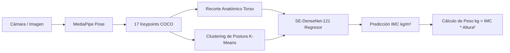

# ⚖️ DigitalScale - Estimación de IMC y Peso Corporal por Visión Computacional

[](https://www.python.org/)
[](https://pytorch.org/)
[](https://developers.google.com/mediapipe)
[](#arquitectura-del-sistema)
[](#)

Sistema integral de visión computacional y aprendizaje profundo para la **estimación del Índice de Masa Corporal (IMC / BMI en $kg/m^2$) y peso corporal ($kg$)** a partir de imágenes de cuerpo entero o video en vivo de webcam, sin necesidad de básculas físicas.

Basado en la arquitectura **SE-DenseNet-121** (Squeeze-and-Excitation DenseNet) con extracción de postura mediante **MediaPipe Pose** y recorte anatómico del torso.

---

## 📋 Tabla de Contenidos
1. [Distribución del Proyecto: Git vs. Google Drive](#-distribución-del-proyecto-git-vs-google-drive)
2. [Arquitectura del Sistema](#-arquitectura-del-sistema)
3. [Estructura del Repositorio](#-estructura-del-repositorio)
4. [Instalación y Configuración](#-instalación-y-configuración)
5. [Guía de Ejecución Rápida](#-guía-de-ejecución-rápida)
   - [1. Demo en Tiempo Real con Webcam](#1-demo-en-tiempo-real-con-webcam)
   - [2. Pipeline de Re-entrenamiento en GPU](#2-pipeline-de-re-entrenamiento-en-gpu-local)
   - [3. Entrenamiento en la Nube (Google Colab)](#3-entrenamiento-en-la-nube-google-colab)
   - [4. Aplicación Móvil Android](#4-aplicación-móvil-android)
6. [Índice de Documentación y Reportes Técnicos](#-índice-de-documentación-y-reportes-técnicos)

---

## ☁️ Distribución del Proyecto: Git vs. Google Drive

Para mantener el repositorio Git ultra liviano (**~2 MB**) y facilitar clonaciones rápidas, los archivos pesados (dataset de imágenes y pesos de la red) se distribuyen vía **Google Drive**:

| Componente | Ubicación | Tamaño | Descripción |
| :--- | :--- | :--- | :--- |
| **Código Fuente & Scripts** | **Repositorio Git** | ~2 MB | Pipeline completo, demo webcam, adaptadores, documentación y modelos de clustering. |
| **Dataset de Imágenes** | **Google Drive** | ~810 MB | Archivo `Entrenar_Data.zip` (o carpeta `Image Dataset/` con ~2,500 imágenes PNG/JPG). |
| **Pesos Entrenados (`best_model.ckpt`)** | **Google Drive** | ~81 MB | Checkpoint del modelo entrenado (MAE: 4.13 $kg/m^2$, MAPE: 13.94%). |

> 🔗 **Enlaces de Descarga en Google Drive**:
> - **Dataset de Imágenes (`Entrenar_Data.zip`)**: `[PEGAR_AQUÍ_LINK_GOOGLE_DRIVE_DATASET]`
> - **Pesos del Modelo (`best_model.ckpt`)**: `[PEGAR_AQUÍ_LINK_GOOGLE_DRIVE_PESOS]`

### ¿Dónde colocar los archivos descargados?
1. **El archivo `best_model.ckpt`**:
   Ubicarlo dentro de la carpeta:
   ```
   DigitalScale/weights/best_model.ckpt
   ```
   *(El script `webcam_demo.py` lo detectará automáticamente allí).*

2. **El archivo `Entrenar_Data.zip`** (Solo necesario si vas a re-entrenar):
   Descomprimirlo dentro de `Entrenar_Data/` de modo que quede la estructura:
   ```
   Entrenar_Data/
   └── Image Dataset/
       ├── Image_train/
       ├── Image_test/
       ├── Image_train.csv
       └── Image_test.csv
   ```

---

## 🧠 Arquitectura del Sistema



1. **Detección de Postura**: `MediaPipe Pose` extrae 33 keypoints anatómicos y los normaliza al formato COCO (17 puntos de referencia: hombros, cadera, rodillas, etc.).
2. **Normalización y Recorte**: El script calcula la bounding box anatómica del torso y ajusta la escala para eliminar ruido del fondo.
3. **Clustering de Postura**: Un modelo PCA + K-Means clasifica la postura del sujeto para calibrar la regresión.
4. **Regresor SE-DenseNet-121**: La red neuronal procesa el torso junto con la postura para predecir el IMC numérico con alta precisión.

---

## 📁 Estructura del Repositorio

```
1.-Proyectos GDIAC/
│
├── .gitignore                                # Exclusiones de archivos pesados, temporales y venv
├── requirements.txt                          # Dependencias consolidadas (PyTorch, OpenCV, MediaPipe, etc.)
├── README.md                                 # Documentación principal para ingenieros y usuarios
│
├── DigitalScale/                             # Módulo principal de inferencia y aplicación
│   ├── webcam_demo.py                        # Demo interactivo en vivo con webcam (DirectShow, Timer, UI)
│   ├── weights/                              # Directorio para 'best_model.ckpt' (Descargar de Drive)
│   ├── trained_models/
│   │   └── keypoint_models/                  # Modelos de clustering de postura (kmeans, pca, scaler)
│   │       ├── kmeans.pkl
│   │       ├── pca.pkl
│   │       └── scaler.pkl
│   ├── src/                                  # Código fuente del modelo SE-DenseNet y helpers
│   │   ├── models/densenet/densenet.py       # Definición de la red SE-DenseNet-121
│   │   └── helpers/torso_crop.py             # Algoritmo de recorte anatómico de torso
│   └── app/android/                          # Código fuente nativo de la App Android (Kotlin + CLAID)
│
├── Entrenar_Data/                            # Pipeline de entrenamiento y preparación de datos
│   ├── unified_dataset.csv                   # CSV consolidado con 2,555 registros (train/val/test)
│   ├── dataset_adapter.py                    # Script que genera el CSV unificado desde los datos crudos
│   ├── train_rtx3050.py                      # Pipeline de entrenamiento local acelerado por GPU (AMP FP16)
│   └── export_to_digitalscale.py             # Exporta y verifica los checkpoints entrenados a DigitalScale
│
└── 📚 Documentación Técnica Detallada:
    ├── Analisis_DigitalScale_BMI.md          # Análisis arquitectónico y paper original de ETH Zurich
    ├── Analisis_Ejecucion_Webcam.md          # Guía técnica del demo webcam y migración MediaPipe
    ├── Analisis_Pesos_Modelo_IMC.md          # Análisis de la estructura de pesos y estado del checkpoint
    ├── Analisis_Dataset_Original_WayBED.md   # Comparativa WayBED (84k fotos) vs Dataset Local
    ├── Guia_Entrenamiento_Pesos_Veridicos.md # Guía para reproducción de entrenamiento en GPU local
    └── Guia_Informe_Entrenamiento_Google_Colab.md # Informe exhaustivo para entrenamiento en Colab (ZIP/RAR)
```

---

## ⚙️ Instalación y Configuración

### 1. Prerrequisitos
- Python **3.10**, **3.11** o **3.12** instalado en el sistema.
- Cámara web (para la demo en vivo).
- *(Opcional pero recomendado)* Tarjeta gráfica NVIDIA (RTX / GTX) con controladores actualizados para aceleración por GPU.

### 2. Crear y Activar Entorno Virtual

En Windows (PowerShell):
```powershell
python -m venv venv
.\venv\Scripts\Activate.ps1
```

En Linux / macOS:
```bash
python3 -m venv venv
source venv/bin/activate
```

### 3. Instalar Dependencias

**Para habilitar aceleración GPU (CUDA 12.1):**
```powershell
pip install torch torchvision --index-url https://download.pytorch.org/whl/cu121
pip install -r requirements.txt
```

**Para ejecución en solo CPU:**
```powershell
pip install -r requirements.txt
```

---

## 🚀 Guía de Ejecución Rápida

### 1. Demo en Tiempo Real con Webcam

Ejecuta el asistente interactivo con detección de postura, recuadro de alineación y auto-captura con temporizador de 3 segundos:

```powershell
python DigitalScale/webcam_demo.py
```

**Características del Demo:**
- **Auto-detección de cámara**: Utiliza backend `DirectShow` para compatibilidad nativa e instantánea en Windows.
- **Temporizador Inteligente (3s)**: Detecta cuando el sujeto está alineado y de pie frente a la cámara, inicia una cuenta regresiva visual y congela el fotograma para predecir.
- **Predicciones en Pantalla**: Muestra el IMC calculado ($kg/m^2$) y el peso estimado en función de la altura configurada.
- **Controles de Teclado**:
  - `Espacio`: Forzar captura manual de inmediato.
  - `R`: Reiniciar temporizador para nueva medición.
  - `Q` o `ESC`: Salir.

> ⚠️ **Nota**: Asegúrate de haber colocado `best_model.ckpt` en `DigitalScale/weights/` antes de iniciar la demo.

---

### 2. Pipeline de Re-entrenamiento en GPU Local

Si dispones del dataset descargado en `Entrenar_Data/Image Dataset/`:

1. **Generar / Validar el Dataset Unificado:**
   ```powershell
   python Entrenar_Data/dataset_adapter.py
   ```
   *Genera `Entrenar_Data/unified_dataset.csv` agrupando sujetos para evitar data leakage entre entrenamiento y validación.*

2. **Iniciar Entrenamiento con PyTorch + AMP FP16:**
   ```powershell
   python Entrenar_Data/train_rtx3050.py
   ```
   - Optimizado para GPUs como RTX 3050 (Batch size 16, lr 1e-4, 20 épocas).
   - Utiliza aumento de datos (rotación, flip horizontal, jitter de color).
   - Genera el mejor checkpoint en `Entrenar_Data/output/best_model.ckpt`.

3. **Exportar Pesos al Módulo de Inferencia:**
   ```powershell
   python Entrenar_Data/export_to_digitalscale.py
   ```
   *Copia automáticamente los pesos validados a `DigitalScale/weights/` y ejecuta un forward pass de prueba para certificar el modelo.*

---

### 3. Entrenamiento en la Nube (Google Colab)

Para entrenar en la nube con GPUs gratuitas (Tesla T4) sin consumir recursos de la laptop:
- Consulta la guía completa: [Guia_Informe_Entrenamiento_Google_Colab.md](file:///j:/Documentos/Proyectos/1.-Proyectos%20GDIAC/Guia_Informe_Entrenamiento_Google_Colab.md).
- Incluye el código listo para copiar y pegar en celdas de Colab con soporte automático de descompresión para archivos **ZIP** y **RAR**.

---

### 4. Aplicación Móvil Android

El código de la aplicación nativa para smartphones se encuentra en `DigitalScale/app/android/`:
- Escrito en **Kotlin**.
- Utiliza **CLAID** (Cross-Language Architecture for Interactive Distributed Systems) para la inferencia móvil local.
- Para compilar el APK, abrir la carpeta `DigitalScale/app/android` directamente en **Android Studio**.

---

## 📚 Índice de Documentación y Reportes Técnicos

En la raíz del proyecto se incluyen 6 documentos de análisis detallado elaborados durante el desarrollo del proyecto:

1. 🔬 [Analisis_DigitalScale_BMI.md](file:///j:/Documentos/Proyectos/1.-Proyectos%20GDIAC/Analisis_DigitalScale_BMI.md)  
   *Análisis exhaustivo del paper científico original de ETH Zurich y arquitectura SE-DenseNet.*
2. 📹 [Analisis_Ejecucion_Webcam.md](file:///j:/Documentos/Proyectos/1.-Proyectos%20GDIAC/Analisis_Ejecucion_Webcam.md)  
   *Detalles de ingeniería sobre la migración a MediaPipe Pose y la optimización del demo de webcam.*
3. ⚖️ [Analisis_Pesos_Modelo_IMC.md](file:///j:/Documentos/Proyectos/1.-Proyectos%20GDIAC/Analisis_Pesos_Modelo_IMC.md)  
   *Inspección de capas internas, tensores y estado de los pesos del modelo.*
4. 📊 [Analisis_Dataset_Original_WayBED.md](file:///j:/Documentos/Proyectos/1.-Proyectos%20GDIAC/Analisis_Dataset_Original_WayBED.md)  
   *Comparativa profunda del dataset original WayBED (84,000 imágenes) frente al dataset local.*
5. 💻 [Guia_Entrenamiento_Pesos_Veridicos.md](file:///j:/Documentos/Proyectos/1.-Proyectos%20GDIAC/Guia_Entrenamiento_Pesos_Veridicos.md)  
   *Guía paso a paso para la reproducción del entrenamiento en hardware local.*
6. ☁️ [Guia_Informe_Entrenamiento_Google_Colab.md](file:///j:/Documentos/Proyectos/1.-Proyectos%20GDIAC/Guia_Informe_Entrenamiento_Google_Colab.md)  
   *Manual e informe detallado para montar el pipeline en Google Colab con soporte ZIP y RAR.*

---

## 👥 Créditos y Referencias
- **DigitalScale Original Framework**: ETH Zurich - [Repository](https://github.com/im-ethz/DigitalScale)
- **Pose Estimation**: Google MediaPipe Pose (BlazePose GHUM 3D)
- **Pipeline & Adaptaciones**: Proyecto GDIAC (2026)
