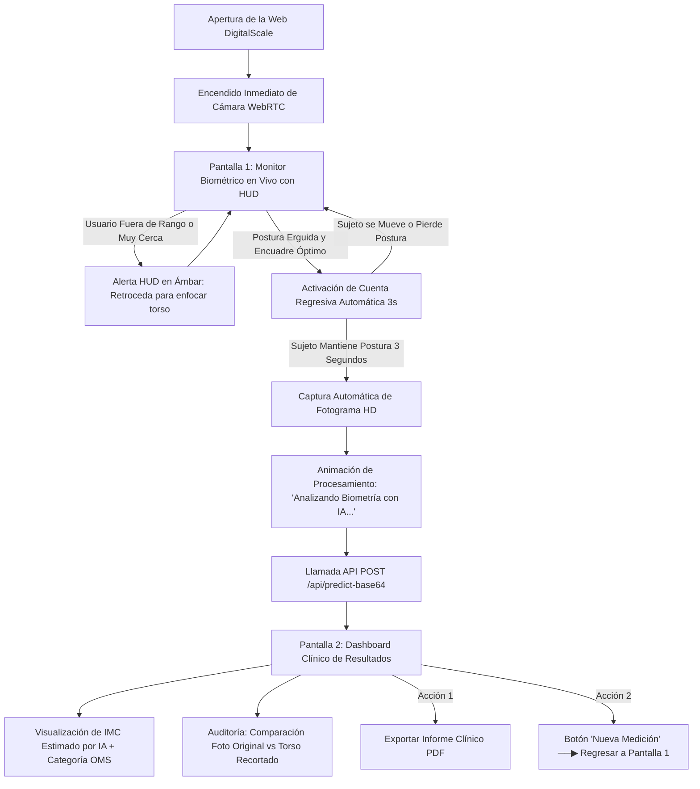

# 🎨 Especificación de Diseño y Pantallas: Frontend Web DigitalScale AI

Documento maestro de arquitectura de interfaz de usuario (UI/UX), flujos de interacción, componentes interactivos y sistema de diseño para la aplicación web de estimación de **Índice de Masa Corporal (IMC)** por visión computacional.

---

## 📌 1. Visión del Producto: Medición Automática Zero-Input con IA

### 🎯 Principio Científico y Funcional Fundamental

**El sistema calcula el Índice de Masa Corporal (IMC en $kg/m^2$) de forma 100% automática y directa a partir de la imagen de la cámara, SIN requerir que el usuario introduzca su estatura, peso ni ningún dato manual.**

```
               MÉTODO TRADICIONAL (Requiere 2 mediciones físicas manuales)
               [ Báscula (Peso kg) ] + [ Tallímetro (Estatura m) ] ──▶ IMC = Peso / Estatura²

               MÉTODO DIGITALSCALE (Estimación Biométrica Autónoma)
               [ Cámara Web ] ──▶ [ MediaPipe Pose ] ──▶ [ Torso 224x224 ] ──▶ [ SE-DenseNet-121 ] ──▶ IMC Estimado por IA (kg/m²)
```

La red neuronal profunda **SE-DenseNet-121 (Squeeze-and-Excitation DenseNet)** fue entrenada con el dataset biométrico WayBed para mapear directamente las características morfométricas, volumétricas y de proporción del torso humano al valor continuo del IMC. Por lo tanto:

1. **La estatura NO es necesaria** para predecir el IMC.
2. **El peso NO es necesario** para predecir el IMC.
3. El usuario obtiene una estimación biométrica orientativa e instantánea.

---

### 💎 Pilares de Experiencia de Usuario (UI/UX en Modo Claro Médico)

1. **Cero Entrada Manual (Zero-Input)**:
   - Al cargar la página, la cámara se activa de inmediato tras el consentimiento del navegador.
   - Sin formularios de registro, sin preguntas previas de altura, peso o edad.
2. **Estética Clínica Limpia y Luminosa (Clean Medical Light Theme)**:
   - Diseño moderno en **tonos claros** (blancos puros `#ffffff`, gris suave `#f8fafc` y slate `#0f172a`).
   - Transmite higiene, profesionalismo, luminosidad y confianza médica, idóneo para entornos clínicos, consultorios o uso personal diurno.
   - Sombras suaves de elevación (*soft shadows*) y tarjetas con bordes delgados y pulidos (`#e2e8f0`).
3. **Feedback Biométrico en Tiempo Real (HUD Interactivo)**:
   - Capa Head-Up Display sobre el visor de la cámara con silueta guía dinámica.
   - Detecta si el usuario está erguido o si se encuentra demasiado cerca de la cámara (`⚠️ Demasiado Cerca`).
   - Dispara una **cuenta regresiva inmersiva de 3 segundos** únicamente cuando la postura y el encuadre son estables.
4. **Dashboard de Resultados con Jerarquía Visual Nítida**:
   - **Resultado Primario**: Rótulo destacado **`Índice de Masa Corporal Estimado por IA`** con tipografía de alto impacto y velocímetro semicircular (*Gauge Meter*) calibrado con los rangos de la OMS.
   - **Auditoría de Visión Artificial**: Visualización de la imagen capturada frente al recorte del torso centrado de $224 \times 224$ px analizado por la red neuronal (libre de bandas negras).

---

## 🧭 2. Diagrama de Flujo del Usuario (User Journey)



---

## 🖥️ 3. Especificación Detallada de Pantallas (Modo Claro)

La aplicación es una **Single Page Application (SPA)** de dos pantallas con transiciones fluidas:

---

### 🟢 PANTALLA 1: Escáner Biométrico en Vivo (Live Camera HUD)

Esta pantalla se renderiza por defecto. Su objetivo es asegurar que la persona se posicione a la distancia adecuada para que la red neuronal reciba un encuadre perfecto del torso.

```
┌────────────────────────────────────────────────────────────────────────┐
│ ⚖️ DigitalScale                                      ● Sistema: Online │
├────────────────────────────────────────────────────────────────────────┤
│                                                                        │
│   ┌────────────────────────── VISOR DE CÁMARA ─────────────────────┐   │
│   │ 🔴 EN DIRECTO                                                  │   │
│   │                                                                │   │
│   │                  ┌──────────────────────┐                      │   │
│   │                  │     ┌──────────┐     │                      │   │
│   │                  │     │  CABEZA  │     │                      │   │
│   │                  │     └────┬─────┘     │                      │   │
│   │                  │   ┌──────┴───────┐   │  (Silueta Guía       │   │
│   │                  │   │   TORSO Y    │   │   Dinámica)          │   │
│   │                  │   │   HOMBROS    │   │                      │   │
│   │                  │   └──────┬───────┘   │                      │   │
│   │                  │     ┌────┴─────┐     │                      │   │
│   │                  │     │ CADERAS  │     │                      │   │
│   │                  │     └──────────┘     │                      │   │
│   │                  └──────────────────────┘                      │   │
│   │                                                                │   │
│   │          ┌───────────────────────────────────────────┐         │   │
│   │          │  ⏱️ CAPTURANDO EN 3... (Anillo Animado)    │         │   │
│   │          └───────────────────────────────────────────┘         │   │
│   │                                                                │   │
│   │  [ 🟢 Postura Correcta: Quédese quieto para medir su IMC ]    │   │
│   └────────────────────────────────────────────────────────────────┘   │
│                                                                        │
│              [ 📸 Captura Manual ]      [ 🔄 Cambiar Cámara ]              │
│                                                                        │
│   ┌────────────────────────────────────────────────────────────────┐   │
│   │ 💡 Consejos de Posicionamiento:                                │   │
│   │ • Párese erguido a 1.5 - 2 metros de la cámara.                │   │
│   │ • Asegúrese de que sus hombros y torso estén dentro del cuadro.│   │
│   │ • El cálculo de su IMC se realizará de manera 100% automática. │   │
│   └────────────────────────────────────────────────────────────────┘   │
└────────────────────────────────────────────────────────────────────────┘
```

#### Elementos y Comportamientos Clave:

1. **Header Clínico**:
   - Logotipo: `⚖️ DigitalScale` con tipografía moderna en tono slate oscuro `#0f172a`.
   - Monitor de estado de la API (`GET /api/health`):
     - `● Online` con luz verde esmeralda y fondo blanco con borde suave.
     - `○ Conectando...` en ámbar si el servidor está iniciando.
     - `✕ Servidor Desconectado` en rojo suave en caso de error de red.
2. **Lienzo de Video WebRTC y Canvas de Realidad Aumentada**:
   - Elemento `<video>` enmarcado en un contenedor blanco con esquinas redondeadas (`border-radius: 16px`) y sombra sutil.
   - Reflejo horizontal en modo espejo (`transform: scaleX(-1)`).
   - Elemento `<canvas>` superpuesto idéntico en dimensiones donde se dibuja el HUD.
3. **Lógica de Estados del HUD en Tiempo Real**:
   - **Estado A: Buscando Sujeto (Azul Médico `#0284c7`)**:
     - Silueta punteada en reposo. Mensaje: *"Ubíquese frente a la cámara enfocando su torso superior"*.
   - **Estado B: Advertencia de Proximidad (Ámbar Clínico `#f59e0b`)**:
     - Se activa cuando los hombros o caderas tocan los márgenes de la pantalla o la distancia inter-hombros supera el 50% del ancho del encuadre.
     - Mensaje: *"⚠️ Demasiado Cerca: Por favor retroceda un paso para enfocar su torso completo"*.
   - **Estado C: Postura Correcta y Alineada (Verde Esmeralda Salud `#059669`)**:
     - Silueta se ilumina sólidamente con un brillo suave.
     - Inicia inmediatamente la cuenta regresiva de 3 segundos.
4. **Temporizador Circular Animado (Countdown Ring)**:
   - Anillo SVG centrado con cuenta decreciente: `3`... `2`... `1`...
   - Si el usuario se mueve bruscamente durante el conteo, se reinicia para evitar tomas desenfocadas.
   - Al finalizar, emite un efecto visual de destello blanco (*flash biométrico*) y congela el fotograma para enviar a la API.
5. **Barra de Acciones en Tarjeta Blanca**:
   - **Disparador Manual (📸)**: Botón primario con fondo verde azulado médico para capturar de inmediato sin esperar el temporizador.
   - **Selector de Entrada de Video (🔄)**: Alterna de forma dinámica entre cámara frontal, trasera o webcam externa.

---

### 🔵 PANTALLA 2: Dashboard Clínico de Resultados del IMC

Aparece tras una transición suave cuando el backend responde exitosamente a `POST /api/predict-base64` o `POST /api/predict`.

```
┌────────────────────────────────────────────────────────────────────────┐
│ ⚖️ DigitalScale                                     [ 🔄 Nueva Medición ] │
├────────────────────────────────────────────────────────────────────────┤
│                                                                        │
│                        RESULTADO DE EVALUACIÓN                         │
│                                                                        │
│   ┌────────────────────────────────────────────────────────────────┐   │
│   │ 📊 ÍNDICE DE MASA CORPORAL ESTIMADO POR IA                     │   │
│   │                                                                │   │
│   │                     23.45 kg/m²                                │   │
│   │                                                                │   │
│   │              [ 🟢 NORMAL (RANGO SALUDABLE) ]                   │   │
│   │                                                                │   │
│   │       Bajo Peso       Normal       Sobrepeso      Obesidad     │   │
│   │       (<18.5)      (18.5 - 24.9)  (25.0 - 29.9)    (≥30.0)     │   │
│   │       [======]     [===========]  [===========]  [========]    │   │
│   │                          ▲                                     │   │
│   │                          │ (Su posición estimada)              │   │
│   └────────────────────────────────────────────────────────────────┘   │
│                                                                        │
│   ┌─────────────────────────────┐   ┌──────────────────────────────┐   │
│   │ 🔍 AUDITORÍA DE VISIÓN IA   │   │ 💡 DIAGNÓSTICO CLÍNICO (OMS) │   │
│   │                             │   │                              │   │
│   │ Foto Original    Torso Real │   │ Su Índice de Masa Corporal   │   │
│   │ ┌──────────┐    ┌─────────┐ │   │ se encuentra en un estado    │   │
│   │ │          │ ──▶│         │ │   │ saludable y normopeso.       │   │
│   │ └──────────┘    └─────────┘ │   │                              │   │
│   │ Postura: Erguida (Validada) │   │ • Riesgo cardiovascular: Bajo│   │
│   │ Tensor: 224x224 (L-Crop Fix)│   │ • Estado metabólico: Óptimo  │   │
│   └─────────────────────────────┘   └──────────────────────────────┘   │
│                                                                        │
│   ┌────────────────────────────────────────────────────────────────┐   │
│   │ ℹ️ Esta medición es una estimación biométrica orientativa      │   │
│   │    calculada mediante visión por computadora (IA).             │   │
│   └────────────────────────────────────────────────────────────────┘   │
│                                                                        │
│                      [ 📄 Descargar Informe PDF ]                      │
│                                                                        │
└────────────────────────────────────────────────────────────────────────┘
```

#### Componentes Clave del Dashboard:

1. **Velocímetro Semicircular de IMC Estimado por IA (Gauge)**:
   - Tarjeta principal sobre fondo blanco (`#ffffff`) con borde gris suave (`#e2e8f0`).
   - Título explícito: **`📊 Índice de Masa Corporal Estimado por IA`**.
   - Cifra en tamaño prominente (`3.5rem`), bold tipográfico y unidad `$kg/m^2$`.
   - Arco de 180° sobre fondo claro con los cuatro segmentos según la escala oficial OMS:
     - 🟦 **Bajo peso**: $< 18.5$ (`#0284c7` - Azul cielo médico)
     - 🟩 **Peso normal**: $18.5 - 24.9$ (`#059669` - Verde esmeralda clínico)
     - 🟨 **Sobrepeso**: $25.0 - 29.9$ (`#d97706` - Ámbar médico)
     - 🟥 **Obesidad**: $\ge 30.0$ (`#dc2626` - Rojo coral clínico)
   - Aguja o marcador animado que viaja desde 0 hasta el valor obtenido con suavizado de curva (*ease-out*).
2. **Tarjeta de Auditoría de Visión Artificial (Transparencia Médica)**:
   - Exhibe la captura completa del usuario junto al recorte del torso (`cropped_torso_base64`) de $224 \times 224$ px procesado por la IA.
   - Demuestra visualmente que el algoritmo centró adecuadamente la silueta sin bandas negras artificiales.
   - Badge informativo: `Postura: Erguida (Validada)`.
3. **Tarjeta de Diagnóstico y Orientación Clínica (OMS)**:
   - Interpretación de salud contextualizada según el rango obtenido.
   - Recomendaciones de hábitos saludables y nivel de riesgo cardiovascular estimado.
4. **Nota Médica Aclaratoria (Footer Clínico)**:
   - Cuadro informativo sutil en fondo de apoyo (`#f8fafc`) con borde `#e2e8f0`:
     *"Esta medición es una estimación biométrica orientativa calculada mediante visión por computadora (IA). Para un chequeo médico presencial, consulte a un especialista."*
5. **Acciones**:
   - **Botón "Nueva Medición"**: Limpia los estados y reactiva la cámara en Pantalla 1.
   - **Botón "Descargar Informe PDF"**: Genera una hoja clínica formateada lista para imprimir o guardar.

---

## 🎨 4. Sistema de Diseño (Design System en Modo Claro Clínico)

### 🎨 Paleta de Colores (Clean Medical Light Theme)

```css
:root {
    /* Fondos y Superficies Claras */
    --bg-app: #f8fafc;                  /* Gris hielo clínico muy suave */
    --bg-surface: #ffffff;              /* Blanco puro para tarjetas y modales */
    --bg-surface-subtle: #f1f5f9;       /* Fondos secundarios de apoyo */
    --border-color: #e2e8f0;            /* Bordes limpios y discretos */
    --border-color-focus: #cbd5e1;

    /* Sombras y Elevaciones */
    --shadow-sm: 0 1px 3px 0 rgba(0, 0, 0, 0.05);
    --shadow-md: 0 4px 6px -1px rgba(0, 0, 0, 0.06), 0 2px 4px -2px rgba(0, 0, 0, 0.04);
    --shadow-lg: 0 10px 15px -3px rgba(0, 0, 0, 0.05), 0 4px 6px -4px rgba(0, 0, 0, 0.03);

    /* Textos (Alto Contraste y Legibilidad) */
    --text-primary: #0f172a;            /* Slate oscuro / carbón médico */
    --text-secondary: #475569;          /* Gris pizarra intermedio */
    --text-muted: #94a3b8;              /* Gris claro para leyendas */

    /* Acentos Médicos y Funcionales */
    --accent-primary: #059669;          /* Verde esmeralda salud */
    --accent-primary-hover: #047857;
    --accent-blue: #0284c7;             /* Azul cian médico / HUD */
    --accent-blue-subtle: #e0f2fe;      /* Azul claro para badges */
    --accent-amber: #d97706;            /* Alerta de proximidad */
    --accent-amber-subtle: #fef3c7;
    --accent-red: #dc2626;              /* Alertas críticas y obesidad */

    /* Escala Oficial de la OMS en Modo Claro */
    --who-underweight: #0284c7;         /* Azul cian (<18.5) */
    --who-normal: #059669;              /* Verde esmeralda (18.5 - 24.9) */
    --who-overweight: #d97706;          /* Ámbar (25.0 - 29.9) */
    --who-obese: #dc2626;               /* Rojo coral (≥30.0) */
}
```

### ✍️ Tipografía

- **Cifras Métricas del IMC, Títulos y Badges**: Google Font **`Outfit`** (pesos 600, 700, 800) para un aspecto tecnológico, nítido y moderno sobre fondo blanco.
- **Textos Clínicos, Leyendas y Tablas**: Google Font **`Inter`** (pesos 400, 500) para máxima legibilidad médica.

---

## 🔌 5. Matriz de Integración con el Backend FastAPI

El frontend consume directamente los servicios modularizados en [`DigitalScale/backend/server/`](file:///j:/Documentos/Proyectos/1.-Proyectos%20GDIAC/DigitalScale/backend/server/):

| Endpoint | Método | Payload Enviado | Respuesta Recibida | Uso en el Frontend |
| :--- | :--- | :--- | :--- | :--- |
| `/api/health` | `GET` | *Ninguno* | `{"status": "ok", "gpu_available": true, "device": "cuda:0"}` | Conectar el badge de estado en el header al iniciar la web. |
| `/api/predict-base64` | `POST` | `{"image_base64": "data:image/jpeg;base64,..."}` | `{"status": "success", "bmi": 23.45, "category": "Normal", "posture_cluster": 1, "is_upright": true, "cropped_torso_base64": "..."}` | Disparado tras los 3 segundos de cuenta regresiva en el visor de la cámara. |
| `/api/predict` | `POST` | `FormData` (archivo binario `file`) | Mismo schema de respuesta que `predict-base64`. | Endpoint multiparte disponible para integraciones de prueba o envíos binarios directos. |

---

## 📱 6. Arquitectura de Archivos en `DigitalScale/frontend/`

```
DigitalScale/frontend/
├── index.html              # Estructura semántica SPA (Visor HUD + Dashboard Resultados)
├── css/
│   └── style.css           # Sistema de diseño en Modo Claro Clínico, animaciones y responsive
└── js/
    ├── app.js              # Controlador principal de la aplicación y navegación de pantallas
    ├── camera.js           # Manejo de WebRTC, enumeración de dispositivos y captura de fotogramas
    ├── hud.js              # Dibujo sobre Canvas 2D: silueta guía, alertas y cuenta regresiva 3s
    ├── api.js              # Cliente HTTP para consultar /api/health y /api/predict-base64
    └── gauge.js            # Renderizador del velocímetro semicircular de IMC estimado por IA
```
